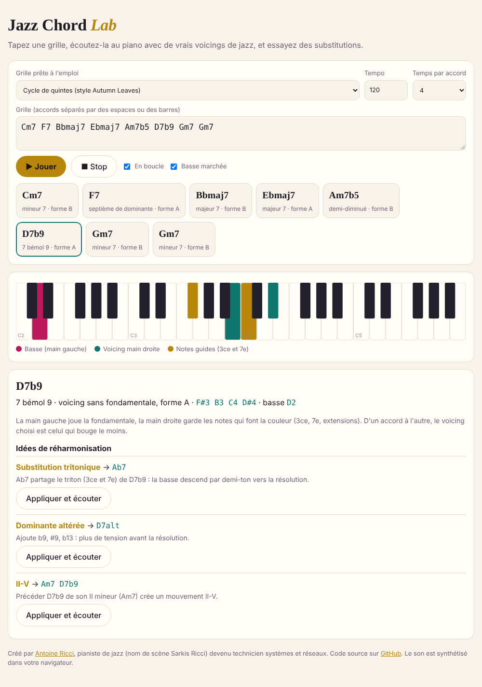

# 🎹 Jazz Chord Lab

**Type a chord chart, hear it played with real jazz piano voicings, and try reharmonisations.**

**▶️ [Open the lab](https://t800lostinhumanity-svg.github.io/jazz-chord-lab/)** (interface in French) — the sound is synthesised in the browser, nothing to install.

## What it does

- **Reads jazz chord symbols**: `Cmaj7`, `Dm7`, `G7`, `Bm7b5` / `Bø`, `Ebdim7`, `E7b9`, `D7alt`, `C6`, `Fm9`, `G7sus4`, `C13`…
- **Voices them like a jazz pianist**: left hand on the root, right hand on a *rootless* voicing (A or B form: 3rd, 7th and extensions).
- **Voice leading**: for each chord it picks the voicing that moves the hand the least from the previous one, the way pianists comp through a II-V-I.
- **Plays the progression** with a simple walking bass, adjustable tempo, loop.
- **Shows every note** on a 4-octave keyboard, guide tones (3rd and 7th) highlighted.
- **Suggests reharmonisations** and lets you hear them in one click: tritone substitution, altered dominant, II-V insertion, secondary dominant, passing diminished chord, colour changes (maj9, 6).
- Ready-made charts: major and minor II-V-I, cycle of fifths (Autumn Leaves style), jazz blues in F, rhythm changes.

## Why I built it

Before IT, I was a professional jazz pianist (stage name **Sarkis Ricci**), touring from Paris to Berlin and teaching music theory in Berlin. This project joins both worlds: the harmony I used to teach, turned into a small, tested piece of software.

## Tech

- Plain **HTML / CSS / JavaScript**, Web Audio API for the sound (additive synthesis, no samples), SVG keyboard
- Music theory engine in [`theory.js`](theory.js): chord parser, voicing templates, voice-leading search, substitution rules
- Tests with Node's built-in runner (`node --test`): parsing, guide tones present in every voicing, smooth voice leading on II-V-I, tritone and secondary-dominant rules

---

**Author:** Antoine Ricci (Sarkis Ricci) — former jazz pianist, Systems & Network Technician in training · [GitHub](https://github.com/t800lostinhumanity-svg) · [LinkedIn](https://www.linkedin.com/in/antoine-ricci-389471452/) · MIT licence

🇫🇷 *Tapez une grille d'accords, écoutez-la au piano avec de vrais voicings de jazz sans fondamentale, et essayez des substitutions (tritonique, II-V, dominante secondaire, diminué de passage).*
